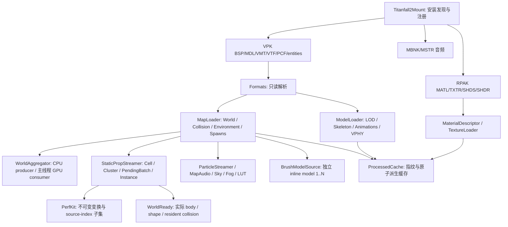

# Titanfall 2 挂载全文件审阅与功能改进

日期：2026-10-30。保留本轮开始时的全部工作区改动，在现有实现上修复运行时功能。本报告区分源码实现、定向回归和实际地图验收；已有历史报告中的性能、部署和 GPU 数字不作为本轮结果。

## 覆盖范围

基线清单来自 `rg --files --hidden engine/Mounting/Sandbox.Mounting.Titanfall2`，包含 **237 个文件**，不含忽略的 bin/obj 和生成缓存。每个文件的关键结构、审阅方式、关注点和本轮改动标记见 [全文件索引](FULL_REVIEW_FILE_INDEX.md)，最终文件 SHA256 见 [CSV 清单](FULL_REVIEW_FILE_INDEX.csv)。

| 范围 | 文件数 | 审阅重点 |
| --- | ---: | --- |
| Formats | 19 | BSP/CM/inline/PVS、MDL/VVD/VTX、动画/物理、PCF、VMT、环境与光照记录 |
| Pak | 13 | RPAK/VPK/STARPAK、DXBC、纹理、Miles、LZHAM、来源及缓存边界 |
| Resource | 61 | 地图构造、材质与模型、streamer、资源所有权、音频、天空和后处理 |
| Perf + PerfKit | 68 | 生产聚合/实例批次、离线入口和 58 个验证脚本的结构与依赖 |
| Native | 34 | 两个 bridge 的 ABI/清理/构建；第三方 LZHAM 接口、许可和文件指纹 |
| Build | 3 | Steam SDK 引用、源文件排除和配置 |
| 模块根目录 | 39 | 挂载入口、配置、日志、部署、项目和历史文档 |

覆盖的含义是逐文件结构盘点、关键调用链和风险边界审阅。未把第三方库称为逐行算法审计，未反汇编 vendored `.lib`，也未把 58 个脚本称为已逐一运行。历史文档保留阶段证据；当前状态以生产源码和本报告为准。

## 关键结构与数据流

所有权层次：mount 保留共享粒子纹理/资源目录、RPAK 缓冲和 inline 数据；cached MapLoader 保留生成世界及其 lightmap 资源；场景组件管理自己的 native objects、GPU buffer、音频句柄与临时子树。后台任务只准备 CPU 数据，Material/Mesh/Model/Texture 在主线程创建。

## 本轮实现

### VTX triangle strip 正式转三角面

`Formats/Titanfall2MeshExtractor.cs` 现在按每个 strip 的拓扑生成三角面，而非把整组索引无条件当 triangle list：

- `TRILIST` 按三个索引成面。
- `TRISTRIP` 按连续三索引展开，奇偶面交替绕序。
- 重复顶点形成的退化连接不提交，但仍推进 strip 奇偶性。
- 每个 strip 单独重新开始奇偶性；索引直接引用 strip-group 顶点，不再次叠加 VertexOffset。
- 保留没有 strip 描述的合成/旧输入所用 group triangle-list 路径。
- 无效顶点映射和越界三角面明确失败，避免静默跳过单个索引后拼成错误拓扑，或在原点生成缺失顶点。

拓扑 flags 与组索引语义依据 [Valve optimize.h](https://raw.githubusercontent.com/ValveSoftware/source-sdk-2013/master/src/public/optimize.h)；[VRAD 消费路径](https://raw.githubusercontent.com/ValveSoftware/source-sdk-2013/master/src/utils/vrad/vradstaticprops.cpp)同样按 strip indexOffset 访问组索引。Source 兼容依据不等于所有 Titanfall 定制拓扑都已实图验收。最终渲染器的统一绕序转换保持现有约定。

### 静态 prop、粒子与实验天球正确启停

`StaticPropStreamer` 直接创建的 SceneObject 和实例批次不受 Component.Enabled 自动管理。现在禁用时隐藏 native 对象和 fallback，停用所属 prop collider；启用时恢复已记录的可见性，并在加载结束时应用当前 Active 状态。PVS、LOD、实例身份和资源计数继续保留。

首次 Configure 会重新开放在空 OnAwake 中消耗掉的初始化机会；旧空 prop 场景仍按原约定完成空 resident preload，损坏非空 payload 继续失败。

生成的 prop collider 与粒子子树设为 `NotSaved`，防止保存/复制宿主时同时复制运行时对象和它们的 encoded 重建源。粒子组件禁用时停用其已创建系统，启用时按相机距离重新激活。

`SkyDome` 同步管理 native 模型的启停；完整解码后再创建对象，创建中途失败回收已创建模型。此处是实验 sky dome，默认 3D skybox 桥接策略没有变更。

### 地图音频所有权、启停与距离选择

`MapAudio` 重新配置先停止旧 emitter，再回收自己创建的 soundscape zone。移除组件时，包括被移出宿主的 zone 也能正确回收；不会按 `NotSaved` 标志遍历删除其他系统的对象。

生成的 zone 不保存/复制，持久来源是 EncodedZones。禁用组件也会禁用 zone trigger，启用后恢复；zone 的 Volume 现在应用配置的 VolumeScale。两个 payload 完整解码后才发布运行时资源，截断的后续 zone 不留下前面创建的 trigger。

新 emitter 只在 authored play radius 内启动；已播放声音使用更大的 stop radius 保留迟滞。失败启动同样消耗每次刷新预算，避免一帧连续尝试大量失败解码。

### 世界聚合异常后结束后台生产

`Perf/Titanfall2WorldAggregator.cs` 增加取消令牌，Parallel 和 bounded queue 的 Add 都观察取消。主线程的材质/mesh 创建抛错时，通过 finally 取消并等待 producer 退出，再释放队列。避免消费提前结束后，producer 长期堵在满队列上、持有整批几何。

### 损坏纹理缓存回退到导入器

`Texture.Cache.cs` 不再把“非空 bytes”当作有效缓存：校验转换器实际产生的格式、自然 mip 上限、cube 的方形/面数，并计算每级每个 surface 的完整字节数。长度不符返回 cache miss，继续从 RPAK/STARPAK 重建，避免坏缓存持续命中后只能生成白色回退纹理。

### 松散依赖读取与部署失败回滚

`LooseAssetSource.TryReadPath` 统一双分隔符，拒绝绝对路径、盘符和父目录穿越，并将路径解析异常转换为读取失败。合法 game-relative 和相邻文件依赖继续可用。

`Deploy-Steam.ps1` 记录本次尝试写入的目标，预先核实位于 mount 目录内。失败时删除本次引入、备份中不存在的 payload 文件，再恢复旧文件；首次安装失败也不保留这些半成品。只移除本次 payload 文件，不递归删除安装目录。原有仅覆盖恢复备份的逻辑会遗漏新加入的 DLL/shader source。本轮只修改脚本并做语法检查，没有运行 Steam 部署，也没有进行真实安装失败演练。

### 文档校正

`ARCHITECTURE.md` 将原始 CM 选择与 DeferredNavMesh 分开，并更新 compiled local lights 的实际接线。`MOUNT_REQUIREMENTS_STATUS.md` 更新已实现的独立 brush 路径，保留门/电梯/剧情行为的边界。`PerfKit/README.md` 更正为按实际成员变化重建裁剪子集。旧阶段报告不重写为本轮新证据。

## 尚未完成的功能

| 领域 | 当前限制与后续功能重点 |
| --- | --- |
| gameplay collision | 默认仍是 render fallback；原始 CM 为显式开关。保留 contents/provenance 不等于 player/Titan/bullet/grapple 查询分类已经导入 |
| dedicated server | prop streamer 仍有 DontExecuteOnServer；pure-world 常驻契约不能据此宣称服务器可用 |
| 模型功能 | 默认 bodygroup 已有实现；非默认 skin/bodygroup 的完整切换、LOD material replacement、命名 attachments、正式 HitboxSet/hitgroup 接入仍缺失或不完整 |
| 动画 | 已有 RLE、include 与 root movement 路径；sequence blend、事件/activity、完整 AG2 clip/skeleton 契约和全部角色兼容性未完成 |
| 材质 | 统一 MATL/VMT/PCF 描述已在用；全部 Source/Respawn proxy、任意二维变换、实体驱动输入、detail normal/mask 等仍有覆盖边界 |
| 纹理 | RPAK/VTF、动画 sheet、cubemap 已在用；Texture.cs 的 TGA 分支仍是 stub；高 mip 动态升级未实现 |
| 音频 | source sound 可解码，soundscape 使用单 loop/球形近似；完整 event 随机变体、作者衰减和真实 trigger brush 区域未完成 |
| 粒子 | 只实现 PCF 的部分 operator；按名独立 prefab 契约和全部控制点/子效果语义尚未完成 |
| 多地图环境 | fog/light/compiled-light 绑定到 Scene.RenderAttributes；同 Scene 多地图同时激活的仲裁仍需设计，不能把单组件销毁成功当多地图环境完全隔离 |
| 画面与资源 | SP 固定机位原作对照、长时间换图、显存回收、所有地图渲染压力仍未最终验收 |

没有通过猜测 contents/tag、曝光或强制打开实验开关来掩盖这些差异。

## 必要验证与证据

本轮中途按用户要求将精力转向功能实现，没有继续扩展测试体系。此前已加入的三个小型回归文件保留；测试用于确认修复边界，不作为功能完成度的替代。

- 当前 managed solution：`dotnet build engine/Sandbox-Engine.slnx -c Release --no-restore`，**0 warning / 0 error**。
- 最终 `SboxBuild test --no-build --filter FullyQualifiedName~Titanfall2`：Engine **197/197**、Integration **5/5**，共 **202/202**。本轮开始时基线为 167+5 项。
- 初始新边界用例有 20 项失败，确认了音频 zone、纹理缓存及 loose path 问题；修复后通过。旧空 prop 场景 ready 的两项兼容性回归曾在本轮中间版本失败，生产实现已修正，最终两项通过。
- SboxBuild Developer 在本轮前期构建成功；最终标准流程首次遇到 SSL EOF，重试仍卡在远端 manifest 查询，已停止，采用现有 native 工件完成上述 managed 构建。没有修改构建器绕过网络步骤，也不将最终标准全流程描述为通过。
- 本轮改动 C# 的定向 whitespace 格式验证通过（工具报告加载工作区警告）；部署脚本 PowerShell AST 语法检查通过。
- 未启动/关闭用户编辑器，未修改项目/场景/Play 状态，未部署 Steam，未声称完成新的 GPU、triangle-strip 实图或整图外观验收。

日志、基线指纹和构建产物哈希位于仓库 `.tmp/tf2-full-review/`。全文件索引中的指纹对应最终源码，不应与旧报告中的已部署 DLL 指纹混用。

本轮 source build、本地 mount、Engine 测试目录和 Integration 测试目录的挂载 DLL SHA256 四份一致：`C9611A90DDC24D0F87493A2DCDEFA49A163F163E7757007473DA498D0C4E9096`。这只确认本地构建/测试产物身份，不代表 Steam 安装已更新。
