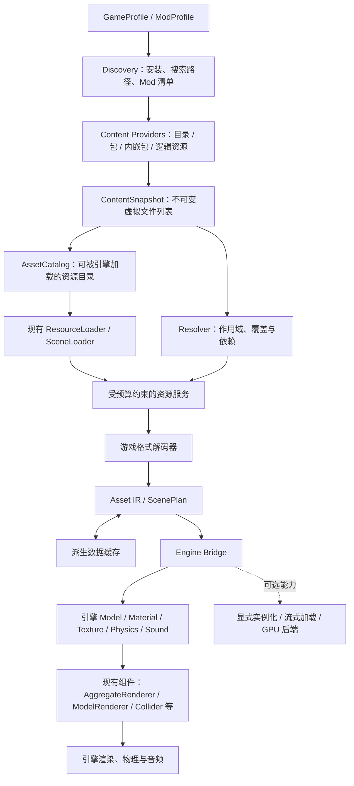
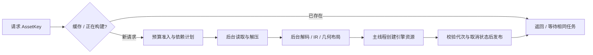

# 可复用游戏挂载框架设计

日期：2026-11-06。状态：设计提案，尚未实现或完成运行期验收。

目标环境：当前 `D:\sbox\sbox-public`，源码基线 `ae85320aa5add9f333b93a5efe375995db83df5f` 加现有工作区修改。本文核对了当前文件，不能据此假定 Steam 正式版、其他提交或正在运行的进程具备相同接口。

## 1. 设计结论与范围

采用 **虚拟内容索引 → 依赖解析 → 中间数据 → 引擎资源桥接 → 引擎原生组件** 的结构。游戏差异收敛在安装发现、搜索路径、容器格式、资源解码和语义映射五处。渲染、物理、场景、音频优先交给引擎。

性能策略是提前完成可复用的解析和布局工作，减少运行期托管对象、重复转换、同步 I/O 和资源提交。自建 GPU 场景不是通用框架的起点。优先使用现有 `AggregateRenderer`、`ModelRenderer`、模型 LOD、材质与纹理构建器、原生碰撞和声音资源，再用实测决定是否添加扩展后端。

六项需求对应如下：

| 用户要求 | 方案中的落实方式 |
|---|---|
| 不改引擎源码 | 只新增/修改 `engine/Mounting/` 的框架与适配器，以及需要部署的 `game/mount/` 模块内容；引擎其他目录只读 |
| 尽量提高运行期性能 | 不可变索引、依赖缓存、同资源请求合并、派生数据缓存、空间分片、原生聚合与 LOD、静态数据不逐帧更新 |
| 尽量复用引擎 | 继续使用 `BaseGameMount`、`ResourceLoader`、`SceneLoader<T>` 与引擎自有组件；不维护第二套通用物理和场景系统 |
| 参考其他项目 | 已检索并查看公开项目源码；可借鉴点与适用限制见[研究附录](MOUNT_FRAMEWORK_RESEARCH.zh-CN.md) |
| 高复用、迁移到其他游戏 | 通用核心不认识 BSP、RPAK、VMT、Northstar；用能力接口与游戏配置表达差异，以第二个游戏验证复用 |
| 虚拟文件列表与 Mod | 文件索引与引擎资源目录分离，统一 loose/archive/地图内嵌/逻辑子资源，显式定义覆盖、作用域、补丁与依赖规则 |

本方案支持资产 Mod、地图 Mod、声明式补丁。原游戏脚本、原生 DLL、原游戏玩法和网络协议的执行不由挂载框架自动提供。需要游戏逻辑的实体输出语义记录，由使用挂载内容的游戏负责解释。

## 2. 修改边界与交付方式

### 2.1 允许的目录

```text
engine/Mounting/
  Framework/                         新增：共享源码、契约、测试、文档
    Core/                            不引用 Sandbox.Engine 的内容与调度核心
    Bridge/                          只调用现有引擎接口
    Build/                           共享源码导入与模块构建入口
    Tests/                           独立测试项目；显式排除模块的默认 Compile 通配
  Sandbox.Mounting.<Game>/            游戏适配器、格式读取器、注册逻辑
  docs/                              本设计与研究附录

game/mount/<module>/
  <module>.dll                       构建产物，不提交
  Assets/shaders/mounts/<module>/     必须保留原作语义时使用的模块 shader
  Assets/materials/mounts/<module>/   模块自带资源，使用唯一前缀
```

不修改 `Sandbox.Engine`、`Sandbox.System`、`Sandbox.Reflection`、`Sandbox.Access`、`Sandbox.Tools`、引擎解决方案、全局构建文件、生成 interop 或原生引擎。即便基础 `Sandbox.Mounting` 项目位于允许目录，第一版也保持它的宿主 ABI 不变，通过派生类和组合接入。

“只改挂载目录”约束的是框架源代码和模块内容。运行时可在用户可写缓存目录保存派生数据，不写原游戏安装目录；缓存目录是部署配置，不是新的源码修改范围。

### 2.2 共享代码如何部署

当前引擎按 `mount/<folder>/<folder>.dll` 发现模块，不能假定放进一个共享 DLL 就会自动正确加载。第一版用共享源码导入文件，把 `Core` 和 `Bridge` 编译进每个模块：模块仍输出一个入口 DLL，不增加宿主程序集解析需求。

共享实现使用模块内部类型；只有适配器入口需要成为可发现的 `BaseGameMount` 派生类。共享代码不定义需要跨 DLL 交换的公共运行期单例，不在多个模块中重复注册相同组件名。类型命名可由导入时生成的模块命名空间隔离。版本、许可证和公共源码仍在一处维护，不复制出多份分叉。

代价是多个模块同时启用时，代码和部分缓存各有一份。第一版接受这一明确代价；不以反射修改宿主加载器来消除它。跨模块共享服务只在已有正式部署接口经验证后引入。

新增测试项目放在 `engine/Mounting/Framework/Tests/`，单独构建和执行，不要求修改 `engine/Tests/`。实际实现阶段仍需使用 SboxBuild 完成适用的全仓检查；若它不能发现新测试，另外执行框架测试入口，不宣称它已自动纳入 CI。

## 3. 当前代码已经证明什么

| 已核对的源码 | 可使用的能力 | 必须遵守的边界 |
|---|---|---|
| `Sandbox.Mounting/MountedGame/BaseGameMount.cs` | 安装发现、挂载、刷新、资源目录 | 注册表不是事务式热替换 API；刷新包含 shutdown/remount |
| `Sandbox.Mounting/MountedGame/MountContext.cs` | 用 `Add` 注册资源 loader | 它是 `ref struct`；不能跨 `await` 保持或捕获进后台任务；`AddError` 当前仍是 TODO |
| `Sandbox.Mounting/MountedAsset/ResourceLoader.cs` | 按需构建及结果缓存 | 包装器已有缓存；新框架不能假定自己的 LRU 能清掉所有引擎引用 |
| `Sandbox.Engine/Game/Mount/Directory.cs`，只读 | DLL 发现、`mount://` 访问、模块 Assets 接入 | 发现挂载类型不等于注册所有自定义 Component |
| `Sandbox.Engine/Game/Mount/SceneLoader.cs`，只读 | 临时场景 → 序列化 SceneFile → 销毁临时场景 | `Load` 和 `Shutdown` 为 sealed；`BuildScene` 是同步入口；临时场景与实际场景不是同一个实例 |
| Source 1 `BaseMount.Files.cs`、`BaseMount.Maps.cs` | loose/archive 文件索引、引用计数、地图 pak 作用域 | 当前索引还混合了材质、纹理和地图导入缓存；通用化时应拆开 |
| `AggregateRenderer.cs`、`SceneAggregateObject.cs`，只读 | 同材质模型的片段提交与逐片段剔除 | 单 mesh、兼容材质、draw 与 fragment 一一对应、数量上限；不承诺任意模型直接可用 |
| `ModelBuilder.Mesh.cs`、`ModelBuilder.cs`，只读 | 运行期模型、LOD mesh、LOD 距离 | 外来格式的 LOD/材质/骨骼仍需正确转换 |
| `Graphics.Draw.Mesh.cs`、`CommandList.cs`，只读 | 实例化与间接绘制 | 某些低层 Graphics 方法是 internal；只能使用目标版本真正提供的 public 入口 |

以上是当前源码的静态核对结果。没有在本任务中启动、重启或更新引擎进程，也没有做帧率和视觉验收。

## 4. 总体架构



分三条路径：

1. **内容路径**：发现、建索引、决定谁覆盖谁，不创建 GPU 资源。
2. **转换路径**：读文件、解压、解码、建立依赖、生成中间数据，必要时创建引擎资源。
3. **运行路径**：引擎组件使用已创建资源；挂载核心不逐帧重新查路径、解析材质或扫描全部实例。

通用核心不引用具体游戏格式。Bridge 不读取 VPK/RPAK。格式解析器不直接创建 GameObject。游戏适配器负责把原作含义转换为框架契约。

## 5. 虚拟文件列表：不把原始文件和引擎资源混在一起

### 5.1 四种身份

| 身份 | 示例 | 用途 |
|---|---|---|
| VirtualPath | `materials/wall.vmt` | 原游戏的逻辑路径，Mod 覆盖发生在这里 |
| SourceLocator | 包 ID + entry ID，或根目录 ID + 相对路径 | 实际数据位置，不泄露给依赖方拼接 |
| AssetKey | 游戏、ProfileRevision、Scope、路径、子资源、用途/变体 | 同一文件生成多个资源及缓存隔离 |
| EnginePath | `mount://example/profiles/p01/materials/wall.vmt.vmat` | 引擎注册与资源引用 |

原始文件列表必须保留 `.mdl/.vvd/.vtx/.phy`、脚本、清单等依赖项，即使这些文件不单独出现在资源浏览器。`AssetCatalog` 只发布模型、材质、纹理、声音、场景等可加载资产。

`ResourceLoader` 会补引擎扩展名。路径转换统一由 `EnginePathCodec` 完成，保留源扩展名避免歧义：`foo.wav.vsnd` 与 `foo.mp3.vsnd` 可以共存。不要在各 loader 内各写一份改后缀逻辑。兼容旧挂载路径时单独维护 alias 表，alias 必须指向同一个资源身份。

### 5.2 内容提供者

统一提供目录枚举、条目元数据、定长/分段读取和生命周期，不要求所有容器都能 seek。

| Provider | 责任 |
|---|---|
| DirectoryProvider | 按允许根目录读取 loose 文件，规范路径，跟踪文件身份 |
| ArchiveProvider | 索引包目录，不在挂载时解压全部内容；记录分包和压缩块依赖 |
| EmbeddedArchiveProvider | 地图内嵌 pak，以地图 Scope 隔离 |
| LogicalAssetProvider | RPAK GUID、音频 bank、纹理数组或资源字典中的子资源，生成稳定虚拟条目 |
| GeneratedProvider | 引擎内可重建的派生资产描述符；不是随意往原始文件列表塞 native 对象 |

容器索引中的 offset/length 为 64 位。读取必须检查文件边界、解压输出上限、条目数量和压缩块大小。非 seek 容器提供有预算的块缓存，不能用一个共享 Stream.Position 让并发读取互相覆盖。

带 GUID/hash 的游戏还需要 `NativeAssetId → 候选 AssetKey` 索引。不能把可能冲突的 32 位 hash 当成全球唯一身份，也不能假定每个 RPAK 资源都有文件名。

### 5.3 路径规范

索引边界统一 `/`、移除 `.` 和多余分隔符，拒绝绝对路径、盘符、NUL 和越界 `..`。保留展示用原始拼写；大小写比较策略由 GameProfile 决定，不能用宿主 Windows 的习惯替代原游戏规则。

物理文件读取时验证规范后的最终路径仍位于授权根目录。重解析点默认不跟随；若支持符号链接，要验证真实目标。归档成员同样按虚拟路径规则处理，不能借由 zip 条目读写根外路径。

路径 hash 只是加速键；最终比较规范路径或完整内容摘要。对路径规则版本单独编号，规则变化时使索引与派生缓存失效。

### 5.4 索引结构

建议 `ContentSnapshot` 包含：

```text
SnapshotId / ProfileRevision
Sources[]                              有序内容源与版本
Entries[]                              紧凑条目表
Winners[(ScopeId, VirtualPath)]         O(1) 平均查找
Candidates[(ScopeId, VirtualPath)]      按优先级排列，诊断用
NativeIds[(Namespace, NativeId)]        GUID/hash 候选
ScopeParents[]                         已校验无环
CatalogDescriptors[]                   引擎可注册资产
ResolutionPolicyVersion
```

第一版用字典建立后冻结为只读快照；是否改用 `FrozenDictionary`、字符串池、路径 ID 或磁盘映射，由百万级条目基准决定。候选详情可分离到紧凑数组，避免为每个唯一文件建立小 List。

建索引成本约为 O(N) 加确定优先级的排序；不能宣传整个挂载是 O(1)。运行中通过 winner 表查找，禁止每次 Load 都循环全部包。

## 6. Mod：覆盖规则必须成为数据

### 6.1 Profile 与搜索路径

`GameProfile` 描述基础游戏、DLC、补丁、格式能力、坐标系、材质策略。`ModProfile` 描述启用的 Mod 集合及顺序，构建为一个固定修订版本。

默认优先级建议：

```text
选定 ModProfile 中的用户覆盖层
  > 启用 Mod，按明确的用户覆盖顺序
  > 官方更新/补丁
  > DLC
  > 原版
```

这是框架默认策略，**不是所有游戏的正确顺序**。Source 搜索路径、Northstar 配置、DLC manifest 等由适配器解析为有序 `LayerSpec`，可以完全替换默认策略。每层 loose 与 archive 谁优先也必须配置；不能把“loose 永远优先”写成核心规则。

从高到低排列后采用 first-wins；同优先级用 manifest 顺序和稳定 SourceId 决定，不依赖目录枚举或任务完成顺序。Mod 依赖拓扑顺序与文件覆盖顺序分开表达；A 依赖 B 不自动意味着 A 必须覆盖 B。冲突、缺依赖、互斥、循环依赖均在发布快照前诊断。

### 6.2 文件替换、合并和隐藏

默认是整文件替换。JSON、KeyValues、材质 patch 或包增量补丁只有在适配器声明具体语义时才合并。合并结果自身有版本和依赖摘要，所有输入层进入缓存键。

删除/隐藏使用显式 tombstone，仅在所选游戏策略支持时生效。最高优先级 winner 若损坏，报告该 Mod 资源失败；不能悄悄加载被覆盖的原版资源，让用户误以为 Mod 生效。可选的容错模式必须记录降级原因和实际来源。

多文件模型使用 bundle 策略：先解析主文件，再在同一解析上下文查 companion 文件。默认按游戏搜索路径允许上层覆盖某个 companion；版本/checksum 不兼容则失败。某些格式要求同包一致性时，适配器声明 bundle 原子替换，不靠物理“同目录文件”绕过 VFS。

### 6.3 地图与依赖作用域

解析顺序由 Scope 确定，例如：

```text
MapLocal(mp_a) → ModProfile(p01) → BaseGame(example)
```

地图 A 内嵌的 `materials/wall.vmt` 不进入地图 B 的全局 winner。材质再引用纹理、VMT 再 include 其他 VMT、模型再引用材质时，传播同一个 Scope 和 Snapshot，而不是只对最外层文件使用它。

每次转换持有固定快照；中途不转到最新索引。MapLocal 是否高于外部 Mod 由游戏规则决定。引擎路径也编码作用域，例如 `profiles/p01/maps/mp_a/_pak/materials/wall.vmt.vmat`，使引擎缓存不会把地图 A 与 B 的同名材质合并。

地图内嵌目录与逻辑子资源目录需在 `MountContext.Add` 发布前获得：读取包目录、地图头/嵌入目录和必要元数据即可，不解析整张地图几何。大容器可从持久化目录缓存恢复。第一版不依赖挂载完成后悄悄追加 loader，因为现有资源树不会自动提供完整事务更新。

### 6.4 Mod 清单例子

下面是拟定配置，不是已有引擎格式：

```json
{
  "schemaVersion": 1,
  "game": "example",
  "profile": "p01",
  "mods": [
    { "id": "texture-pack", "version": "1.0", "overridesAfter": ["base-fix"] },
    { "id": "base-fix", "version": "2.0", "requires": [] }
  ],
  "sourcePolicy": "example-searchpaths-v1",
  "changesApply": "next-session"
}
```

清单只描述允许根目录内的数据源。Mod 数据中的脚本/DLL不会因此自动执行。

### 6.5 更新与缓存边界

第一版固定会话 Profile：修改 Mod 集合后在下一次引擎会话应用。可同时预注册多个 Profile 命名空间，但每个 loader 必须持有自己的上下文。不要在同一个 `mount://` 地址下无声切换内容。

这比“刷新一下所有资源必定更新”更严格，也更符合当前宿主能力：`RefreshInternal` 会清理并重挂，但引擎资源库、已克隆场景和 GPU 对象可能仍持有旧引用。以后只有在完整验证缓存失效和场景生命周期后，才提供无活动场景时的刷新。原子发布 VFS 快照不等于原子更新整个引擎。

## 7. 通用契约与游戏适配器

以下是契约草图；类型均为框架拟新增，不是现有 s&box API：

```csharp
interface IContentProvider : IDisposable
{
    SourceId Id { get; }
    IEnumerable<EntryMetadata> EnumerateMetadata();
    ValueTask<ReadLease> ReadAsync( EntryId entry, ReadRange range, CancellationToken ct );
}

interface IAssetDecoder
{
    DecoderId Id { get; }
    bool Supports( in AssetDescriptor descriptor );
    ValueTask<DecodedAsset> DecodeAsync( DecodeContext context, CancellationToken ct );
}

interface IGameAdapter
{
    GameProfile Profile { get; }
    DiscoveryPlan Discover( InstallLocation install, ModProfile mods );
    IEnumerable<AssetDescriptor> BuildCatalog( ContentSnapshot snapshot );
    ScenePlan TranslateScene( DecodedScene source, TranslationContext context );
}

interface IEngineBridge
{
    EngineCapabilities Capabilities { get; }
    // 必须在约定的引擎线程/上下文中调用。
    EngineAsset Materialize( DecodedAsset asset, ResourceBuildContext context );
}
```

`ReadLease` 持有快照与读取缓冲区的所有权，调用方 Dispose 后不再使用内存。解码结果必须说明哪些数据复制、哪些仍持有 lease。不能返回池化数组后立即把它还给池。上面的同步 `Materialize` 是单个资源的原子创建步骤；准备、排队和预算在外层服务完成，不能在它内部悄悄创建无界后台任务。

核心使用内置 .NET 数据类型或自己的坐标/矩阵/ID 类型；Bridge 才转换为 Sandbox 类型。若直接在所有 IR 中使用 Sandbox 类型，便不能再把核心称为独立格式库。

### 7.1 Asset IR 保留的内容

| IR | 必须保留的信息 |
|---|---|
| TexturePayload | 压缩格式、mip 链、颜色空间、array/cube 维度、行布局 |
| MaterialDescription | 表面类型、深度/混合/裁剪语义、纹理角色、sampler、UV、源光照语义、可选特性 |
| MeshPayload | 顶点布局、索引、submesh、材质槽、bounds、LOD、骨骼/蒙皮 |
| CollisionPayload | 原始碰撞分类、静态网格/凸体、surface、trigger、contents、所属实体 |
| ScenePlan | 稳定实体 ID、实例数组、空间单元、引用、灯光/环境、语义记录 |
| AudioPayload | 编码、通道、采样率、循环点、流式读取能力 |

扩展字段通过明确版本的 game payload 提供，不把所有私有格式塞进一个 `Dictionary<string, object>`。例如 Source lightmap、TF2 probe 或特殊水材质保持独立 capability；不以最低公分母损失语义，也不强迫其他游戏实现它们。

## 8. 资源流水线、线程和请求合并



`ResourceLoader` 作为引擎入口并保留其原有缓存行为。框架资源服务解决跨 loader 的共享依赖、IR 缓存和错误状态，不再无条件建一个永久 `Dictionary<string, Model>`。

同一个 AssetKey 的后台工作合并为同一个 task；任务失败和取消时移除对应槽位，防止永久缓存失败。单个等待者取消不应取消其他等待者共享的工作；会话结束才取消整个会话。依赖图检查循环，错误链应输出“模型 → 材质 → 纹理 → 来源层”。

I/O、CPU 解码、主线程构建分别限流。准入同时按任务数和字节数，解压前估计输出，防止几十个大纹理任务一起占满内存。优先级建议为：碰撞/当前需要的主资源 > 依赖 > 邻近预取 > 浏览器缩略图。

后台阶段只处理纯数据，不访问 GameObject、当前 Scene、引擎资源库或未确认线程安全的 native API。主线程使用当前已有的 `MainThread.Wait()` 等 public 入口回到正确上下文；每次发布前核对 generation，旧任务只能丢弃结果，不能写入新会话。

### 8.1 当前入口带来的实际限制

`MountContext` 不能跨 await。先完成 `PreparedCatalog`，再由同步的 `Mount` 循环注册；准备工作可在不捕获 context 的独立阶段执行。第一版可同步等待目录索引，必须如实计入挂载耗时。

普通资源可覆盖 `LoadAsync` 实现分阶段转换。场景使用 `SceneLoader<T>` 时不能假装 `BuildScene` 是异步的：第一版在调用它之前尽量预热纯数据，未命中的首次 `BuildScene` 仍可能阻塞。不得通过反射调用 internal 场景序列化接口来伪造异步支持。

每帧固定毫秒数的创建预算需要实际 tick/pump 入口；只有确认合法入口后才启用。仅有 `MainThread.Queue()` 不等于框架已经获得逐帧预算调度器。基础版不承诺加载期完全无卡顿。

## 9. 渲染：原生路径优先，按内容选择后端

### 9.1 默认路由

| 内容 | 第一选择 | 说明 |
|---|---|---|
| 静态不透明世界几何 | `AggregateRenderer` | 按兼容材质状态分组，空间 cell 保留独立片段 |
| 静态 alpha-test | 验证兼容后用 Aggregate，否则 `ModelRenderer` | 必须验证深度、阴影、法线和裁剪阈值一致 |
| 重复静态 prop | 共享 Model + `ModelRenderer`，保留模型 LOD | 先测引擎的批处理；不把成千上万份重复网格默认展开 |
| 透明/折射/水 | 独立 `ModelRenderer` 或已有专用组件 | 保留排序与 pass 语义，不能按不透明规则合并 |
| 骨骼动画/动态实体 | `SkinnedModelRenderer` / `ModelRenderer` | 交给引擎动画和场景更新 |
| 贴花/灯光/环境/音频 | 合适的引擎原有组件 | 语义无法表达时给出 capability 降级报告 |
| 海量、低变化、重复实例 | 可选显式实例化后端 | 只有原生基线受测量证实受限且扩展入口可用时实现 |

原生批处理资格不保证实际合批。材质变体、render attributes、光照、阴影、mesh、pass 都会拆组。不能仅设置 `Batchable = true` 就宣布 draw call 已下降。

### 9.2 Aggregate 的构建规则

1. 按材质身份、shader 特性、lightmap 页、深度/透明状态、shadow、tint、decal 标志等兼容条件分组。
2. 每组在一个或数个有限空间区间内组织片段。cell 尺寸根据地图尺度和密度试验，不把 TF2 或 Source 1 的常数当通用真理。
3. 模型必须符合引擎所需的单 mesh 与 draw/fragment 映射。超过 `AggregateRenderer.MaxFragments` 时拆成多个 aggregate。
4. fragment bounds 对应真实几何；空、NaN 或无限 bounds 拒绝。不把全图做成一个无限包围盒。
5. 索引基址只应用一次。若索引已加上全局 vertex offset，submesh 的 startVertex 不能再应用相同偏移；以实际 Mesh API 语义验证。
6. 父 renderer 与 fragment 的局部变换不能重复变换顶点；负缩放、法线和切线要专门处理。
7. 构建失败退回相同几何的分块 `ModelRenderer`，不能因聚合失败丢面。重叠后端的几何只能提交一次。

Aggregate 优先降低场景对象与提交成本；不能把它宣传成所有片段合为一个逻辑 draw、三角形自动减少、LOD 自动生成或原作 BSP PVS 自动接入。

### 9.3 模型、材质与纹理

重复模型共享几何和可复用材质。皮肤、bodygroup、LOD、光照变体有完整键；避免每个实例创建一套 Model/Material。只有不兼容或必须烘入顶点的数据才派生模型。

优先使用引擎已有 shader 和 Material 参数。原作独特的烘焙光照、法线编码、混合或透明语义无法表达时，模块 shader 放在自己的 Assets 下，并实现与引擎要求一致的 pass。不能为了强行使用一个通用 PBR shader 而改变透明度和光照。

纹理尽量保留引擎支持的 BC 压缩块与 mip 链，校验 sRGB/linear 语义。不要默认先解码成 RGBA 再重压缩。CPU 字节可分块读取不等于 GPU 纹理已经支持运行期流送；低 mip 先上传与后续 mip 替换只有目标接口支持且验证后才实现。

### 9.4 可选实例化和 GPU 后端的门槛

显式实例化可使用现有 public `Graphics.DrawModelInstanced` / `CommandList` 入口。仍需解决：合法运行期宿主、生命周期、多视图、每 pass 的 LOD/可见集、材质兼容、精确 bounds、阴影和编辑器选择。

`SceneCustomObject` 在临时 BuildScene 中创建后不会自动变成可序列化的运行期组件。自定义 Component 也不能仅加 `[Library]` 就假定挂载发现器会注册到每个 Game.TypeLibrary。当前 `TypeLibrary.AddAssembly` 是 internal；本设计不采用现有 TF2 的反射注册方式作为公共基础。

能力选择通过目标版本的编译探针和最小运行夹具确认，生成模块自己的 `EngineCapabilities` 报告；不在热路径用反射寻找方法。编译期不存在的类型由独立 Bridge 源码变体隔离，不能用一个运行期 bool 掩盖无法编译的引用。缺少 Aggregate 时可以选择分块 ModelRenderer；自定义运行期宿主缺失时，实例化扩展直接禁用。

因此以下能力独立标为扩展，不是第一版交付承诺：

- 自定义组件驱动的静态实例流送。
- GPU 细粒度可见性、实例 compact 与 MDI。
- 利用原作 PVS 在运行期决定片段可见性。
- 需要新增每实例 GPU 光照参数的自定义批次。

扩展可在目标引擎已有合法的类型/系统注册入口时启用，或者未来单独明确允许宿主游戏提供接入组件。当前“只改挂载目录”版本不要求用户额外修改游戏项目。没有入口时保留原生基线，不能把受限能力写成默认已可落地。

GPU 后端通过门槛后，还必须验证多 camera、shadow cascade、reflection、depth、normals、主 pass 的资源隔离与同步；禁止每帧同步 GPU readback。主摄像机看不见的物体仍可能投射可见阴影。几何支持应按 submesh 判定，混合材质模型能拆分时精确拆分，并防止与原生残余路径重复绘制。

## 10. 可见性、LOD 与流式加载

基础版将剔除交给引擎对象/aggregate fragments，并正确提供 bounds、静态标记和已有 LOD。原作 PVS 可以参与离线分区、预取和诊断，但不能未经接口验证就宣称取代了引擎可见性。

流式扩展的 residency、render visibility、physics readiness 分开建模：

```text
Unrequested → Queued → CpuReady → EngineReady → Resident
                                     ↓            ↓
                                  Failed       Evictable → Released
```

驻留不意味着可见；不可见不意味着可以删除。已提交 GPU 工作、活跃 SceneFile、物理引用和其他场景可能仍使用资源。LOD 切换不得成为删除碰撞的理由。

跨 cell 的大物体采用保守 bounds，不能仅按中心点 cell 判定可见。动态物体不使用静态 PVS 作为唯一剔除依据。编辑器相机、游戏相机和其他消费者各自维护需求；使用多消费者并集计算驻留。

流式碰撞必须按玩家/刚体需求区域预取并留安全边界，不能跟着主摄像机视锥销毁。对传送、快速移动和服务器必须有就绪门控。基础版默认先完成必要碰撞，再允许地图进入可交互状态。

## 11. 碰撞与玩法边界

碰撞优先读取原作专用碰撞数据，转换成引擎原生 hull、mesh、`PhysicsGroupDescription` / `PhysicsCollider`、`ModelCollider`、`Rigidbody`。渲染模型、query trace mesh、simulation collision 是不同用途，IR 必须区分。

必须保留世界/prop/动态 brush/trigger、contents、surface、local transform 等信息。静态非凸网格与动态凸体不互相替代。引擎表达不了的 per-face surface 或特殊 contents 在 capability 报告中说明，不静默当作完整支持。

碰撞可以按空间与相容 surface 分组减少组件数量，但不能把世界所有形状无条件揉成一个巨型 body，也不能破坏 trigger 与动态实体边界。服务器读取相同源碰撞和解析规则，只跳过 render/lightmap/GPU/audio 阶段。

导航生成使用引擎能力，属于可配置加载阶段，不默认在地图 Ready 后立即触发全图高开销重建。梯子、门、电梯、出生点等语义可转换到已有组件；未知实体保留诊断和语义数据，不自动执行原游戏脚本。

## 12. 缓存：先保证正确身份，再追求命中率

| 层 | 缓存内容 | 生命周期/预算 |
|---|---|---|
| 目录缓存 | 容器元数据、搜索路径与候选索引 | 随源清单/索引版本失效 |
| 压缩块缓存 | 有复用价值的解压块 | 有界内存，不长期保存全部包 |
| IR 缓存 | 模型/纹理/材质/场景中间数据 | 内存 LRU + 可选磁盘派生缓存 |
| 引擎资源 | Model/Texture/Material 等 | 按真实引擎引用能力管理；不同于 IR LRU |
| SceneFile 关联资源 | 场景序列化引用的运行期生成资源 | 至少覆盖缓存 SceneFile 和实际使用者的生命周期 |

建议派生键：

```text
SHA256(
  CacheSchema + DecoderVersion + PathPolicyVersion + BuildOptions
  + GameProfileVersion + ScopeIdentity
  + ResolvedSourceIdentities + OrderedDependencyDigests
  + BridgeLayoutVersion + relevant Engine/Native compatibility ID
)
```

引擎无关的原始解析 IR 可以省略引擎版本，但引擎布局、shader ABI、碰撞烹饪结果和几何布局必须包含相应兼容版本。NativeAssetId 本身不代表内容版本。

不能只以主文件路径、mtime、文件大小判断正确性。快速目录缓存可先用 size/mtime/包目录摘要筛查；所需 payload 与依赖使用内容摘要或经过验证的源版本身份。开发模式同大小同时间替换、依赖替换和 Mod 重排必须能强制重验证。负查找结果也绑定快照，新增 Mod 后不能永久 miss。

依赖必须记录解析请求和上下文，而不仅是上次 winner 的物理文件：原先缺失的纹理被新增、上层 Mod 加入同名文件、搜索顺序改变，也会改变解析结果。可以用 ProfileRevision 做保守失效，再以精确依赖摘要优化重用。

磁盘缓存只保存可验证的纯数据，不持久化 native handle、裸指针或活的引擎对象。写入临时文件，校验后原子发布；读取验证 magic、schema、摘要、长度和解压上限。损坏、磁盘满和版本不匹配均可回退源转换。格式缓存不能成为必需的唯一数据源。

### 12.1 不能承诺完全掌控显存

引擎 ResourceLoader/资源库/场景/native 层可能继续持有对象。框架释放一个字典引用不等于立刻归还 GPU 内存，也不能在其他使用者存活时 Destroy 共享纹理。

第一版对 IR/读取缓冲使用硬预算，对引擎资源报告估计与可观测值。没有可靠 consumer lease 入口时，运行期生成资源保守保留到对应 SceneFile 缓存/挂载生命周期；这会增加多地图连续打开时的内存压力。超过配置预算时停止新的预取或拒绝新的重资源加载，明确提示结束会话，不能悄悄驱逐仍被序列化场景引用的资源。

按地图精确回收是后续必须单独验证的能力，不能照搬一个自定义 owner Component 然后假定克隆、关闭编辑器预览、进入游戏均已正确计数。

## 13. 生命周期、卸载与失败处理

### 13.1 所有权

| 对象 | Owner | 结束条件 |
|---|---|---|
| Provider/包句柄 | ContentSnapshot | 快照退休且所有读取 lease 归零 |
| 读取 buffer | ReadLease | 解码器不再使用且 lease Dispose |
| CPU IR | 资源服务 | 预算淘汰且没有构建/使用引用 |
| 待创建资源 | BuildTransaction | 成功转移所有权，或失败回滚 |
| 共享引擎资源 | Bridge 资源记录 + 引擎消费者 | 不能只根据某个场景销毁就强制释放 |
| 实际场景组件与其原生对象 | 引擎 Scene | 由引擎组件生命周期删除 |

每个 session 使用单调递增 generation 与取消源。卸载顺序为：拒绝新请求 → 标记退休并取消会话工作 → 禁止旧任务发布 → 释放框架构建状态 → 退休快照 → 在最后读取 lease 归零后关闭包。

当前 `BaseGameMount.Shutdown` 是同步入口，不能在其中死等需要回主线程的 worker，避免死锁。退休和引用计数负责延后关闭；异步任务必须被观察，错误要进入有界诊断。

宿主可能在场景仍存活时触发 unmount。基础版不主动 Destroy 仍可能被使用的共享 native 资源，也不宣称能拦住宿主动作。要验收现有组件/引擎资源的引用行为；如果实际引擎无法保证存活场景继续工作，则将该操作明确列为需先关闭场景的限制。

### 13.2 SceneLoader 特别约束

`BuildScene` 创建的是临时场景；它被转为 SceneFile 后销毁。框架不能把临时场景 OnDestroy 当作真正地图卸载，也不能把自定义 SceneObject 存进临时场景就当作运行期接入完成。

凡 SceneFile 中引用运行期生成 Model/Material/Texture，必须保持资源可寻址且存活；最好通过预注册的生成资源描述符重建，无法预注册时至少保留与 SceneFile 等长的强引用。只保留路径字符串不够。

当前 SceneLoader 的 `Shutdown` sealed；框架场景 loader 的自有 build 资源清理由会话资源服务统一负责。`ReleaseCachedResult` 与 `ReleaseCachedScene` 即便当前源码存在，也不当作其他版本的保证；调用前要验证 target API，且须协调 SceneFile 与关联资源一起失效。

### 13.3 错误策略

- 目录不存在、格式不支持：诊断安装/资源能力，不伪造已完成。
- 可选贴图缺失：使用有标识的 fallback，记录原路径和来源。
- 关键地图数据/必需碰撞缺失：地图不得标为可交互 Ready。
- 单个可选资源失败：不影响其他资源注册；失败是可查询状态。
- 创建资源到一半失败：事务回滚，只释放本次独占资源。
- `MountContext.AddError` 当前不显示错误：模块必须另外输出结构化报告和日志。

日志按同一错误签名限频。稳态渲染不逐帧输出缺失资源或创建匿名统计对象。

## 14. 性能目标与观测

“性能最大化”以质量和碰撞不退化为前提，分别测 CPU、GPU、内存、I/O 与加载时间。不能把静态 prop 的局部结果推导为整图 FPS，也不能把 GPU 等待跨度当成 GPU 实际忙碌时间。

### 14.1 设计约束

| 热路径 | 目标 |
|---|---|
| 静态世界稳态 | 框架不做逐实例托管 Update；引擎剔除与提交 |
| 已驻留资源使用 | 无同步磁盘读、无解压、无路径扫描 |
| 内容定位 | 预建 winner/ID 表；不扫描包列表 |
| 重复请求 | 同 AssetKey 共用构建任务，不重复创建引擎资源 |
| GPU 扩展 | 静态几何/变换不每帧整体上传；不做同步回读 |
| 遥测 | 预分配计数器与采样缓冲；详细快照按需输出 |

这些是待实现的约束，不是当前测量结果。LOD 距离、cell 大小、并发数、内存预算均作为具名配置记录实际生效值，不用几十个隐式环境变量控制核心行为。

### 14.2 基准方法

比较以下可独立运行的模式：

1. `NativeReference`：正确的独立 ModelRenderer/Collider，作为质量基线。
2. `NativeOptimized`：共享资源、空间布局、Aggregate、模型 LOD、派生缓存。
3. `InstancedExperimental` / `GpuExperimental`：仅在能力门槛满足后。

固定硬件、分辨率、画质、相机轨迹、ModProfileRevision、引擎/模块 DLL 与 shader 身份。分别测冷派生缓存、暖缓存；记录操作系统文件缓存状态，不能把删除派生缓存称为完全冷盘。

每模式先预热，再按固定路线至少重复三次，保存原始数据。测试包括静止视图、移动、快速转向、室内外过渡、多视图、进入/退出地图以及长时间驻留。

记录 p50/p95/p99 CPU/GPU 帧时间、主线程 mount 工作、提交对象与 draw/fragment、三角形、native/托管内存、GC 分配、估计/可观测显存、读取/解压字节、缓存命中、Ready 时间和最大卡顿。

可采用初始验收门槛：相同质量下 p95 帧时间不回退超过 3%；启用显著增加复杂度的后端前，在至少两个代表场景证明可重复的 CPU 或 GPU 帧时间收益，同时不恶化主要尾延迟和预算。这些是项目决策阈值，需按测量噪声校准，不是预测收益。

### 14.3 内容诊断命令的拟定输出

```text
mount.explain <profile> <virtual-path> <scope>
  winner、被覆盖候选、命中的搜索规则、依赖作用域

mount.stats <ident>
  entries、catalog、句柄、inflight、IR/native 估计、缓存、错误

mount.verify <ident> <asset>
  文件/依赖摘要、decode/bridge 版本、实际引擎路径、能力降级
```

命令名与注册方式是设计示意。若模块无法通过现有接口注册 console 命令，则由离线诊断入口和模块日志提供相同能力，不能新增反射注册依赖。

## 15. 测试与验收矩阵

| 类别 | 必须覆盖的用例 |
|---|---|
| VFS | loose/archive 同名、大小写、非法路径、hash 冲突、稳定顺序、目录缺失、分包 |
| Mod | 重排、依赖环、互斥、损坏 winner、tombstone、格式专属 merge、bundle 不兼容 |
| Scope | 同名贴图在地图 A/B 中不同、嵌入材质继续引用嵌入纹理、父作用域回退 |
| 缓存 | 主文件/依赖变化、原缺失依赖新增、同大小替换、Mod 重排、schema/shader ABI 变化、截断与损坏 |
| 并发 | 同资源并发、读取中卸载、失败重试、等待者取消、旧代任务迟到、资源依赖环 |
| 模型/材质 | LOD/skin/bodygroup、压缩纹理和颜色空间、阴影与深度、透明排序、混合 submesh |
| Aggregate | 上限前/等于/超过、索引基址、每片段 bounds、负缩放、失败 fallback、片段不丢失 |
| 生命周期 | 临时构建、编辑器打开/关闭、游戏克隆、两个地图并存、重新打开、失败回滚、关闭时后台读 |
| 物理 | 原作碰撞、动态 brush、trigger、surface、快速移动/传送、服务器无渲染路径 |
| 迁移 | 第二个游戏只新增 provider/decoder/profile/translator，不复制主资源服务 |

纯内容/缓存/并发测试在框架独立测试项目运行，不启动引擎。需要 native 的场景和图像测试另设运行期验证入口，仍位于挂载目录。

视觉验收至少比较颜色/法线、alpha cutout、透明、阴影、lightmap/probe、decal、近远 LOD 和多视图。图像相似度不能替代人工检查与碰撞验收。每份运行报告必须记录实际加载的 DLL 和 shader 身份，不能拿另一个工作树的构建结果代替。

## 16. 实施顺序与迁移策略

| 阶段 | 交付内容 | 进入下一阶段的条件 |
|---|---|---|
| P0：契约与能力探针 | public API 编译验证、模块部署验证、类型注册边界、最小 SceneLoader | 只有挂载目录变化；不借用 internal 反射 |
| P1：内容核心 | 路径、provider、snapshot、scope、ModProfile、explain | 独立夹具通过；覆盖顺序与地图隔离确定 |
| P2：资源转换 | AssetCatalog、decoder、IR、依赖、缓存、资源服务 | 第二个小型/不同格式适配器证明复用；缓存失效正确 |
| P3：原生地图路径 | ModelRenderer、Aggregate、LOD、原生碰撞、环境 | 独立基线视觉/碰撞通过；重复开关图行为明确 |
| P4：性能与生命周期 | 代表图基准、连续多图、预算、服务器 | 记录实测，解决 native 资源与 SceneFile 回收边界 |
| P5：可选扩展 | 显式实例化/流送/GPU | 合法运行期入口已验证，且相对原生路径有收益 |

第一轮先用人工可控的文件与两个不同格式样例，完成核心契约；真实内容优先从一个结构较清晰的挂载接入，再选择 TF2 或另一个复杂游戏作为压力适配器。不先重写整套 Titanfall 2。

建议首版具体范围：DirectoryProvider + 一种 archive provider、确定性覆盖与地图 Scope、Model/Material/Texture/Scene 的目录和转换、IR 派生缓存、原生 renderer 与原作碰撞。用 Quake 或另一个结构清晰的挂载作为首个真实接入，用 TF2 的 VPK/RPAK/GUID/伴随模型文件组合检查接口是否足够通用。两者共享核心而非共享格式假设。音频 bank、粒子与格式专属 patch 可按能力逐项补充，不把“空实现返回成功”计为已支持。

对现有 TF2 按阶段迁移：

1. 保留其 format readers 和现有可运行路径，先将读取入口适配到 VFS；所有依赖读取必须经过统一 resolver。
2. 将注册层、源身份、材质/纹理依赖和缓存键接到新 AssetCatalog，验证结果等价。
3. 把地图解析转换为 ScenePlan；分离碰撞、环境、prop、audio 的构建阶段。
4. 用 NativeReference/NativeOptimized 做可回退对比。现有 GPU 路径仅作为可选 TF2 专属能力，不进入通用核心。
5. 只有在画面、碰撞、生命周期和性能验收后，才删除相应旧路径。避免一次性双写两套永久缓存与注册表。

现有 `MountedScenePerfKit` 的聚合、索引和实例不可变数组规则可作为审查素材；提炼时删除 TF2 假设，重新验证所有权和线程约束。现有格式代码也需经过独立用例，不因“以前使用过”就视为正确。

## 17. 关键决策记录

| 决策 | 原因 | 代价/后续 |
|---|---|---|
| 不修改宿主 ABI | 符合目录约束，降低与引擎更新耦合 | 热更新与自定义系统接入受现有接口限制 |
| 共享源码编译进模块 | 不依赖新程序集加载器 | 多模块代码体积和部分内存重复 |
| VFS 与 AssetCatalog 分离 | 原始依赖、逻辑子资源与引擎资源不是一一对应 | 需要显式身份映射 |
| 不可变 Profile/Scope 快照 | 避免并发读取内容串代、Mod 覆盖不确定 | 更新需要新会话或经过验收的刷新 |
| 默认整文件替换 | 规则清楚，适用于多数格式 | merge/patch 必须由游戏适配器实现 |
| 原生组件为基础路径 | 复用引擎剔除/LOD/物理/场景生命周期 | 特殊语义和海量实例仍可能需要扩展 |
| GPU 后端不进入核心 | 多 pass、材质与生命周期成本高，收益依赖场景 | 以独立能力与基准决定是否启用 |
| IR 与引擎资源分别预算 | 引擎引用与 GPU 生命周期不由普通字典控制 | 首版 native 内存回收策略较保守 |

## 18. 待验证事项与明确限制

本设计的确定部分是目录边界、分层、VFS/Mod/Scope/缓存规则和基础引擎接入方式；以下在编码前或相应阶段必须验证：

- 目标引擎版本的 Aggregate、LOD 和材质接口是否与当前源码一致；动态生成模型能否满足 native aggregate 布局。
- 仅调用 public API 时，能否获得合法的自定义运行期组件/系统注册与逐帧调度入口。若不能，扩展后端保持禁用。
- SceneFile 缓存、运行期生成资源、编辑器与游戏克隆之间的真实引用关系；是否有可用的按地图资源释放入口。
- 加载时并发的 `ResourceLoader` 包装行为与主线程同步调用的组合是否会阻塞；框架自己的任务合并不能代替这项验证。
- 第一次地图加载在同步 BuildScene 入口下的最大卡顿。派生缓存能降低它，不能从设计上保证消除。
- 原生物理格式在各游戏的 surface/contents/动态实体映射完整性。
- 服务器启动时模块与碰撞构建路径是否可用；客户端启动成功不等于服务器通过。

上述限制均不要求改引擎来“补齐承诺”。基础版以现有公开入口能够完成并验证的能力为准，扩展能力单独交付。

## 19. 源码与外部依据

详细外部研究、固定提交链接和本地源码索引见[研究附录](MOUNT_FRAMEWORK_RESEARCH.zh-CN.md)。阅读顺序建议：第 1–4 节确认方向，第 5–8 节审查内容与 Mod，第 9–13 节审查性能和生命周期，第 15–18 节确定实施和验收。
